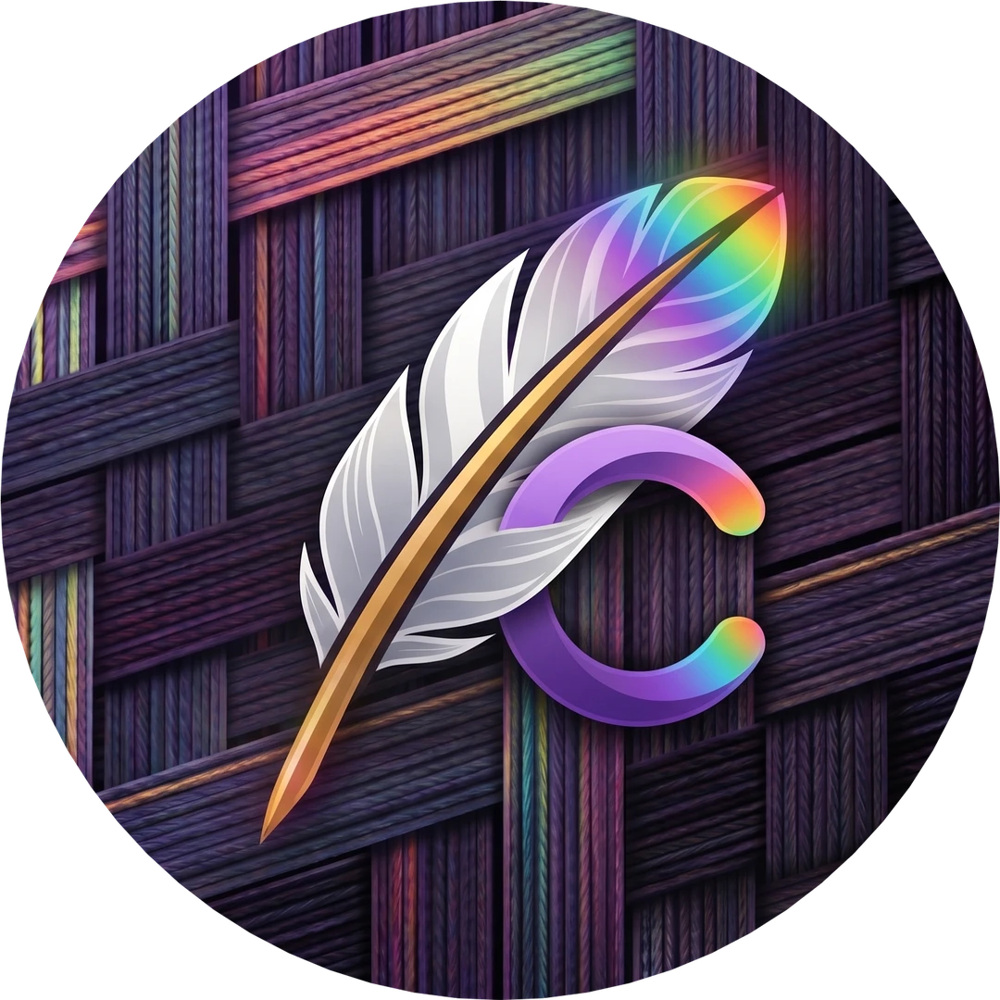

<div align="center">



# CelSuite — Cellium

**Offline Local LLM Studio, Desktop Voice Companion & Multi-Model Orchestrator with 1,520 Procedural Dot-Matrix Expressions.**

[](https://github.com/HenryCarm/CelSuite_Cellium/releases/latest)
[](#-downloads--releases)
[](https://www.qt.io/qt-for-python)
[](https://developer.android.com/kotlin)
[](LICENSE)

<br/><br/>


<br/>

</div>

---

## 🌟 Overview

**CelSuite — Cellium** is an offline-first, private AI assistant and desktop companion that combines the power of modern Large Language Models with a living, expressive procedural dot-matrix avatar. Engineered for both high-end workstations and low-power laptops, Cellium seamlessly bridges cloud intelligence (Gemini, Groq, DeepSeek, Cerebras, OpenRouter) and local offline inference (`llama.cpp` GGUF) with zero telemetry and zero cloud lock-in.

---

## 📦 Downloads & Releases

All desktop packages and mobile clients are built automatically in the cloud via GitHub Actions.

👉 **[Download the Latest Release (v2610.09.0)](https://github.com/HenryCarm/CelSuite_Cellium/releases/latest)**

| Platform | Edition | Format | Compression | Description |
| :--- | :--- | :--- | :--- | :--- |
| 📱 **Android** | Native Kotlin Client | `.apk` | Universal APK | Full mobile chat, Live Call, 1,520 expression avatar studio |
| 🪟 **Windows** | Standalone Folder | `.7z` | Ultra LZMA2 | Maximum compression archive for Windows 10/11 |
| 🪟 **Windows** | Standalone Folder | `.zip` | Standard Deflate | Instant extraction folder with native MSVC runtime |
| 🪟 **Windows** | Portable Single-File | `.exe` | Portable Onefile | Zero-install standalone executable |
| 🐧 **Linux** | Standalone Folder | `.7z` | Ultra LZMA2 | Linux distribution with all bundled Qt and ONNX shared libraries |
| 🐧 **Linux** | Standalone Folder | `.zip` | Standard Deflate | Standard portable distribution folder |
| 🐧 **Linux** | Portable Single-File | `.bin` | Portable Onefile | `chmod +x` and launch directly |

---

## ✨ Key Features

- 🌀 **1,520 Procedural Dot-Matrix Expressions:** 760 Female + 760 Male animations with real-time synchronized blinking, eye tracking, and emotional reactions across 10 modifier styles.
- 📞 **CelAS Live Voice Companion:** Full-screen voice calls with real-time mic-energy metering (VAD), live transcripts, and animated avatar mouth synchronization.
- 🧠 **Collapsible Reasoning Accordions:** Dynamic `<think>` token extraction with interactive 1-click folding cards that keep chat histories neat and readable.
- 🌐 **Unified Multi-Provider Cloud Hub:** First-class support for 11 providers (Google Gemini, Groq, DeepSeek, Cerebras, OpenRouter, SambaNova, Mistral, Together AI, Fireworks AI, SiliconFlow, and Custom OpenAI endpoints).
- 📁 **Offline GGUF Beast Mode:** Run local language models completely offline with zero internet access, customizable GPU layers, context windows, and thread allocation.
- 🐾 **Floating Desktop Companion (Pet Mode):** Always-on-top, frameless desktop avatar that stays on your screen, reacts to your typing, and displays speech bubbles.
- 🎨 **Liquid Glass Aesthetics:** Production-grade glassmorphism, dynamic wallpaper tinting, neon glow dividers, and custom typography.
- 🛡️ **LGPL Compliance:** Built on PySide6 (The Qt Company official LGPL framework).

---

## 🚀 Architecture

```
User Voice / Text Input                       Cellium Core Engine
       │                                                 │
       ├──── Mic-Energy VAD / Speech-to-Text ───────────>│  (Whisper / Web STT)
       │                                                 │
       │<─── Model Dispatch & Stream Handler ────────────┤  (Cloud API / Local GGUF)
       │                                                 │
       ├──── First-Line Mood Contract Extraction ───────>│  (Avatar Reacts Instantly)
       │                                                 │
       ├──── Thought Tag Parser (<think>...</think>) ───>│  (Collapsible Cards)
       │                                                 │
       └──── Text-to-Speech & Phoneme Sync ─────────────>│  (Kokoro / Neural TTS)
```

---

## 🛠️ Quick Setup

### 📱 Android Setup:
1. Download `HenryJayZ.CelSuite.Cellium-v2610.09.0.apk` from the Releases page.
2. Install the APK on your device (grant microphone and overlay permissions).
3. Enter your API key in **Model Hub** or message `/key <gemini_api_key>` in chat.

### 💻 PC Setup (Windows / Linux):
1. Download and extract `CelSuite_Cellium-Windows-Standalone.7z` or `CelSuite_Cellium-Linux-Standalone.7z`.
2. Launch `Cellium.exe` (Windows) or `./Cellium` (Linux).
3. Chat, customize your avatar, or switch to Live Call mode.

---

## 📜 Changelog

See [CHANGELOG.md](CHANGELOG.md) for full version history and release notes.

---

## 📄 License

Distributed under the MIT License. See `LICENSE` for more information.

---

<div align="center">


<sub>Part of the <b>CelSuite</b> ecosystem — programs you didn't know you needed. Built with ❤️ by HenryJayz.</sub>

</div>
